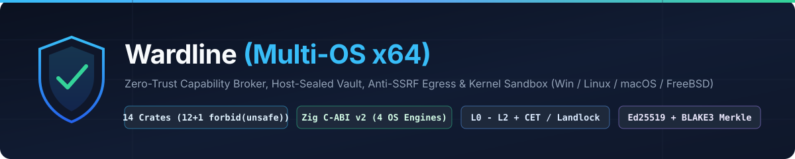

<div align="center">



**Zero-trust capability runtime and kernel containment engine for AI tools & agents across x64 and ARM64.**

[](LICENSE)
[](#architecture)
[](#platform--os-matrix)
[](#platform--os-matrix)

</div>

---

Wardline sits between untrusted AI callers (MCP hosts, LLM agents, CLI automations, Python/TypeScript SDKs) and host resources. Instead of relying on best-effort wrappers or exposing host tokens in child environments, Wardline enforces **default-deny capability certificates**, **multi-OS kernel containment** written in Zig, **reparse/symlink-safe workspace brokering**, **locked-memory secret custody**, **SSRF-pinned HTTPS egress**, and **BLAKE3 + Ed25519 cryptographic audit logs**.

## Architecture


Source vector diagram: [`assets/architecture-x64.svg`](assets/architecture-x64.svg) · Detailed breakdown: [`docs/ARCHITECTURE.md`](docs/ARCHITECTURE.md)

### Defense Zones

1. **Zone 1 — Caller & Hardened IPC Boundary**: `wardline-mcp` (stateless MCP stdio JSON-RPC `2024-11-05` server, `#![forbid(unsafe_code)]`), `wardline` CLI, and thin Python/TypeScript clients communicate with `wardline-guard` over a mutually isolated local channel:
   - **Windows**: Named Pipe (`\\.\pipe\wardline_guard`, `FILE_FLAG_FIRST_PIPE_INSTANCE`, `PIPE_TYPE_BYTE`, `PIPE_REJECT_REMOTE_CLIENTS`, protected `User+SYSTEM` DACL).
   - **Linux / macOS / FreeBSD**: Unix Domain Socket (`0600` permissions + `SO_PEERCRED` / `LOCAL_PEERCRED` UID verification).
2. **Zone 2 — Trusted Computing Base (`wardline-guard`)**:
   - **Capability Authority (`wardline-cert`)**: Ed25519 CBOR certificates (`"wardline.cert.v1\0"`), monotonic delegation attenuation, `redb` Certificate Revocation List (`crl.redb`).
   - **Policy & LOLBin/Path Shield (`wardline-policy`, `wardline-core`)**: Default-deny TOML policy evaluation, 25 Windows + 34 Unix LOLBins blocked, 19 Windows + 14 Unix script extensions blocked, NT/POSIX traversal & alternate-stream rejection, multi-format binary inspection (`PE`, `ELF`, `Mach-O`).
   - **Digest-Bound HITL Approval (`wardline-approval`)**: Single-use tickets stored in `approvals.redb` bound to `BLAKE3("wardline.approval.v1\0" || action)`.
   - **Secret Vault & Cross-Chunk Scrubber (`wardline-vault`)**: `ChaCha20Poly1305` sealed vault wrapped by Win32 DPAPI (`CryptProtectData`) on Windows or `0700/0600 WLV1` custody on Unix, locked in RAM (`VirtualLock` / `mlock`), zeroized on drop, and scrubbed across arbitrary pipe/HTTP chunk boundaries (`[WARDLINE_REDACTED:<grant_id>]`).
   - **Reparse/Symlink-Safe File Broker (`file_broker.rs`)**: Segment-by-segment root walk blocking Windows reparse points/junctions (`FILE_FLAG_OPEN_REPARSE_POINT`) and Unix symlinks (`O_NOFOLLOW`) within `--base-dir`.
   - **Append-Only WLG1 WAL (`wardline-log`)**: `LockFileEx` / `flock(LOCK_EX)` exclusive file lock, BLAKE3 chain links, and Ed25519 checkpoints verified offline by `wardline-verify`.
3. **Zone 3 — Anti-SSRF Pinned Egress (`wardline-egress`)**: Blocks loopback, RFC1918, CGNAT, link-local, cloud IMDS (`169.254.169.254`, `metadata.google.internal`), internal domains, and IPv6 by default; pins a single DNS resolution directly into the TLS dialer; injects authorized credentials host-side.
4. **Zone 4 — Multi-OS Zig Kernel Containment Engines (`platforms/`)**: Unified `C-ABI v1` static libraries linking directly into `wardline-sandbox` across Windows, Linux, macOS, and FreeBSD.

---

## Platform & OS Matrix

| OS / Architecture | Kernel Engine (`platforms/`) | Isolation Mechanisms (`L0` / `L1` / `L2`) | Binary Preflight & HW Telemetry |
|---|---|---|---|
| **Windows x64** | `win-x64/engine_x64.zig` + `sandbox_core.zig` | `L0` RestrictedToken+LowLabel; `L1` AppContainer (0 Net Caps) + JobObject + IOCP; `L2` HCS probe (fail-closed) | Strict PE `0x8664` (`AMD64`), ACG ALWAYS_ON + `CET` Shadow Stack probing |
| **Linux x64 & ARM64** | `linux/engine_linux.zig` + `posix_sandbox.zig` | `L0` `PR_SET_NO_NEW_PRIVS` + `rlimit`; `L1` `UserNS` + `NetNS` + Landlock ABI + seccomp-BPF (`AF_INET`/`AF_INET6`/`AF_NETLINK`/`AF_PACKET` blocked) | ELF64/32 + GNU CET/BTI/PAC notes; `/proc/cpuinfo` `shstk` / `AT_HWCAP` + `/dev/kvm` probe |
| **macOS Intel & Apple Silicon** | `macos/engine_macos.zig` + `posix_sandbox.zig` | `L0` `rlimit` + closed FDs; `L1` Seatbelt SBPL default-deny profile (scoped RO/RW, zero network) | Mach-O & Universal Fat slices (`X86_64`, `ARM64`) |
| **FreeBSD x64 & ARM64** | `bsd/engine_bsd.zig` + `posix_sandbox.zig` | `L0` `rlimit`; `L1` Capsicum `cap_enter()` capability mode + `fexecve()` | ELF64 (`EM_X86_64`, `EM_AARCH64`) |

See [`docs/PLATFORMS_AND_USECASES.md`](docs/PLATFORMS_AND_USECASES.md) for device-class guidance across **x64 workstations, x64 cloud/on-prem servers, ARM64 laptops, ARM64 servers, and ARM64 edge SBCs**, and ready-to-use profile policies under [`schemas/profiles/`](schemas/profiles/).

---

## Quickstart

### Build Native on Windows x64 (`x86_64-pc-windows-msvc`)

```powershell
# Compile all 4-OS x64 Zig containment engines and run native Zig tests
zig build all-engines
zig build test

# Run full workspace lint, unit + live sandbox tests, and build release binaries
cargo clippy --workspace --all-targets -- -D warnings
cargo test --workspace -- --test-threads=1
cargo build --release --bins

.\target\release\wardline.exe doctor --json
```

### Build Native on Linux x64 / macOS / FreeBSD

```bash
cargo clippy --workspace --all-targets -- -D warnings
cargo test --workspace -- --test-threads=1
cargo build --release --bins

./target/release/wardline doctor --json
./target/release/wardline policy validate schemas/profiles/x64-server.toml --json
```

*(If `zig` is not installed on the target host, point `WARDLINE_PREBUILT_ENGINE_DIR` to the directory containing `libwardline_engine_x64.a` built via `zig build linux-x64`.)*

---

## Documentation

- [`docs/ARCHITECTURE.md`](docs/ARCHITECTURE.md) — Crates, Zig C-ABI v1, IPC framing, and trust boundaries
- [`docs/PLATFORMS_AND_USECASES.md`](docs/PLATFORMS_AND_USECASES.md) — Workstations, laptops, cloud servers, edge SBCs, and 4-OS matrix
- [`docs/GUIDE.md`](docs/GUIDE.md) — Build, CLI workflows, MCP setup, and Python/TypeScript SDK integration
- [`docs/POLICY.md`](docs/POLICY.md) — Policy v1 TOML reference, isolation levels, architecture gates, and LOLBin rules
- [`docs/CLI_AND_MCP.md`](docs/CLI_AND_MCP.md) — CLI command reference and MCP JSON-RPC tool schemas
- [`docs/THREAT_MODEL.md`](docs/THREAT_MODEL.md) — Defender assumptions, attacker model, and structural mitigations
- [`docs/TEST_RESULTS.md`](docs/TEST_RESULTS.md) — Reproducible verification runs across Windows & Linux

## License

Dual-licensed under [MIT](LICENSE-MIT) or [Apache-2.0](LICENSE-APACHE).
