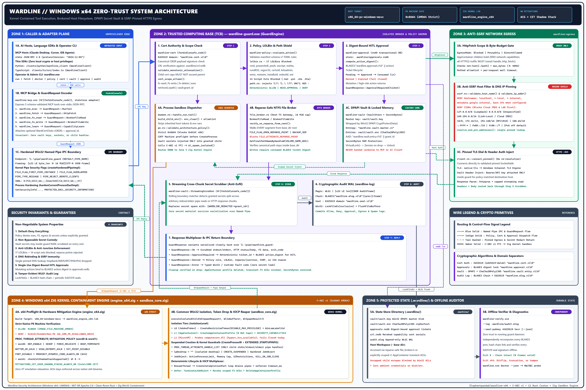

<div align="center">
  
</div>

<p align="center">
  <strong>Clean-Room Zero-Trust Capability Broker, Kernel Process Sandbox &amp; Anti-SSRF Egress Runtime for Windows x64</strong>
</p>

<p align="center">
  <a href="docs/ARCHITECTURE.md"></a>
  <a href="docs/ARCHITECTURE.md"></a>
  <a href="docs/THREAT_MODEL.md"></a>
  <a href="docs/POLICY.md"></a>
  <a href="LICENSE-MIT"></a>
</p>

---

**Wardline (`win-x64`)** is a clean-room Windows security boundary designed for AI agents, Model Context Protocol (MCP) hosts, and automated developer tooling running on **`x86_64-pc-windows-msvc`**. Rather than allowing untrusted prompts or LLM-driven tool loops to spawn arbitrary Windows binaries, touch raw credentials, or access local/cloud metadata networks, Wardline interposes a **hardened single-instance broker daemon (`wardline-guard.exe`)** paired with a **Zig Win32 kernel isolation engine (`wardline_engine_x64`)**.

> [!IMPORTANT]
> Looking for the Windows on ARM64 edition (`aarch64-pc-windows-gnullvm` with Prism emulation controls and `engine_arm64.zig`)? See the sibling repository [`Elephantpanda6/Wardline-ARM64`](https://github.com/Elephantpanda6/Wardline-ARM64).

---

## System Architecture (`win-x64`)

Every tool call, file read/write, and HTTPS request follows an explicit five-zone control and data boundary: **Caller / MCP Adapter** → **Hardened Named Pipe IPC (`\\.\pipe\wardline_guard`)** → **Trusted Computing Base (`GuardEngine`)** → **Anti-SSRF Pinned Egress / Zig `x64` Kernel Sandbox** → **Protected `.wardline/` State & Offline Auditor (`wardline-verify.exe`)**.

<p align="center">
  <a href="assets/architecture-x64.png">
    
  </a>
</p>

<p align="center">
  <sub>Rendered at <strong>4800×3200</strong> from clean vector source: <a href="assets/architecture-x64.png">architecture-x64.png</a> • <a href="assets/architecture-x64.svg">architecture-x64.svg (lossless SVG)</a> • <a href="docs/ARCHITECTURE.md">Full Architectural Walkthrough →</a></sub>
</p>

---

## Key Capabilities & Security Guarantees

| Layer | Security Mechanism (`wardline-x64`) | Enforcement Point |
| :--- | :--- | :--- |
| **Capability & Delegation Auth** | Ed25519 signed `WardCertChain` over canonical CBOR (`"wardline.cert.v1\0"`) with monotonic leaf attenuation and durable `redb` CRL checks (`crl.redb`). | [`wardline-cert`](crates/wardline-cert/) |
| **LOLBin & Path Escape Shield** | Default-deny TOML v1 policy blocking **25 Windows LOLBins** (50 `.exe`/bare patterns: `cmd`, `powershell`, `pwsh`, `mshta`, `rundll32`, `regsvr32`, `certutil`, `bitsadmin`, `wmic`, `wsl`, …), **19 script extensions**, `\\?\` / `\\.\` / `\??\` prefixes, UNC `\\`, drive-relative paths (`C:foo`), and NTFS Alternate Data Streams (`:`). | [`wardline-core`](crates/wardline-core/), [`wardline-policy`](crates/wardline-policy/) |
| **Native `x64` PE Preflight & Hardware Mitigations** | Strictly accepts `0x8664` (`IMAGE_FILE_MACHINE_AMD64`), rejecting `x86` (`0x014C`) and foreign PE headers (`WL_ERR_PE_DISALLOWED_ARCH`). Applies DEP, SEHOP, force-relocate, heap-terminate, high-entropy ASLR, extension-point & font disable, optional ACG (`PROHIBIT_DYNAMIC_CODE_ALWAYS_ON`), and CET User Shadow Stack when supported (`checkCetShadowStackSupported()`). | [`platforms/win-x64/engine_x64.zig`](platforms/win-x64/engine_x64.zig) |
| **Win32 Kernel Process Containment** | **L0** (`CreateRestrictedToken` + `WinLowLabelSid`) & **L1** (`CreateAppContainerProfile` with 0 network capabilities, `lpDesktop = ""`, `PROC_THREAD_ATTRIBUTE_HANDLE_LIST`, `JobObject`, and IOCP reaper + teardown cleanup). *(L2 probes `computecore.dll` and fails closed today.)* | [`platforms/common/sandbox_core.zig`](platforms/common/sandbox_core.zig) |
| **Reparse-Safe Host NTFS File Broker** | Walks every path segment from `--base-dir` with `FILE_FLAG_OPEN_REPARSE_POINT \| FILE_FLAG_BACKUP_SEMANTICS`, rejects NTFS junctions/symlinks (`FILE_ATTRIBUTE_REPARSE_POINT`), verifies `GetFinalPathNameByHandleW(VOLUME_NAME_DOS)`, and requires consumed `BLAKE3` approvals on writes. | [`file_broker.rs`](crates/wardline-guard/src/file_broker.rs) |
| **DPAPI Vault & Streaming Redaction** | Master key `vault.key` sealed by Win32 `CryptProtectData`; entries sealed with `ChaCha20Poly1305` (`"wardline.vault.entry.v1\0" \|\| grant_id`); `SecretBytes` pinned via `VirtualLock` + `Zeroize`; `StreamingScrubber` redacts `[WARDLINE_REDACTED:<grant_id>]` across arbitrary chunk boundaries. | [`wardline-vault`](crates/wardline-vault/) |
| **Anti-SSRF DNS-Pinned Egress** | Single-lookup DNS pinning (`resolve_and_pin_addresses`) + `connect_pinned` over Windows Schannel (`native-tls`). Drops `localhost`, `.local`, `.internal`, `metadata.google.internal`, loopback, RFC1918, `169.254.0.0/16` IMDS, `100.64.0.0/10`, `::ffff:`, and IPv6 by default. | [`wardline-egress`](crates/wardline-egress/) |
| **Single-Use HITL Approvals** | `ApprovalStore` backed by `redb` (`approvals.redb`) binding every gated write/request to its canonical `BLAKE3` digest (`"wardline.approval.v1\0"`). | [`wardline-approval`](crates/wardline-approval/) |
| **Tamper-Evident Audit WAL** | Binary `WLG1` append-only log (`[u32 LE len][CBOR AuditFrame]`), `LockFileEx` exclusive locking, `BLAKE3` chaining, periodic `Ed25519` seals, and standalone verification via `wardline-verify.exe`. | [`wardline-log`](crates/wardline-log/), [`wardline-verify`](crates/wardline-verify/) |

---

## Quickstart (`x86_64-pc-windows-msvc`)

### Prerequisites

- **Windows 10 / 11 (x64)** with MSVC C++ Build Tools / Windows SDK linker
- **Rust toolchain** targeting `x86_64-pc-windows-msvc` (set as default in [`.cargo/config.toml`](.cargo/config.toml))
- **Zig `0.17.1`** on `PATH` (or in WinGet packages; automatically linked by `wardline-sandbox/build.rs`)

### 1. Build, Lint & Test

```powershell
# Build & verify the Zig x64 kernel sandbox engine + shared C-ABI tests
zig build
zig build test

# Lint the entire 12-crate Rust workspace (warnings treated as errors)
cargo clippy --workspace --all-targets -- -D warnings

# Run unit tests + live Win32 AppContainer / JobObject / NTFS junction tests
cargo test --workspace

# Build optimized release binaries (with /DYNAMICBASE, /NXCOMPAT, /HIGHENTROPYVA)
cargo build --release --bins
```

### 2. Probe Host Kernel Capabilities

```powershell
.\target\x86_64-pc-windows-msvc\release\wardline.exe doctor --json
```

Example output on Windows 11 x64 (`Build 26300`):

```json
{
  "abi": 1,
  "capabilities": {
    "abi_version": 1,
    "appcontainer_supported": 1,
    "arch": 1,
    "cet_shadow_stack_supported": 0,
    "hyperv_hcs_available": 1,
    "is_wow64_emulated": 0,
    "job_object_iocp_supported": 1,
    "os_build_number": 26300,
    "pac_bti_available": 0,
    "page_size": 4096,
    "reserved": [0, 0]
  },
  "distro": "win-x64"
}
```

### 3. Validate Policy, Store a Secret & Start the Guard + MCP Bridge

```powershell
$bin = ".\target\x86_64-pc-windows-msvc\release"

# 1. Validate the default-deny policy manifest
& "$bin\wardline.exe" policy validate .\schemas\wardline.v1.toml

# 2. Seal an API token bound strictly to https://api.github.com/
& "$bin\wardline.exe" vault set --grant-id gh_ro --host api.github.com --secret-env GITHUB_TOKEN

# 3. Terminal A: Start the single-instance Named Pipe guard daemon (\\.\pipe\wardline_guard)
& "$bin\wardline-guard.exe" --policy .\schemas\wardline.v1.toml --base-dir . --state-dir .\.wardline

# 4. Terminal B: Attach the zero-secret stdio MCP adapter for Claude Desktop / Cursor / IDE hosts
& "$bin\wardline-mcp.exe" --pipe \\.\pipe\wardline_guard

# 5. Independently verify the tamper-evident WAL audit log offline
& "$bin\wardline-verify.exe" --log .\.wardline\audit.wlog --json
```

---

## Repository Layout

### Workspace Binaries (4)

| Binary | Crate | Trust Role | Purpose |
| :--- | :--- | :--- | :--- |
| `wardline.exe` | [`wardline-cli`](crates/wardline-cli/) | Operator CLI | `doctor`, `run`, `fetch`, `policy`, `cert`, `vault`, `approve`, `audit`, `guard-serve`, `mcp`. |
| `wardline-guard.exe` | [`wardline-guard`](crates/wardline-guard/) | **Trusted Computing Base (TCB)** | Enforces certificates, policy, approvals, DPAPI vault, NTFS broker, SSRF egress, and Zig child isolation over `\\.\pipe\wardline_guard`. |
| `wardline-mcp.exe` | [`wardline-mcp`](crates/wardline-mcp/) | Unprivileged Adapter (`#![forbid(unsafe_code)]`) | Stateless stdio JSON-RPC `2024-11-05` MCP server exposing `wardline_exec`, `wardline_fetch`, `wardline_fs_read`, `wardline_fs_write`, and `wardline_learn`. |
| `wardline-verify.exe` | [`wardline-verify`](crates/wardline-verify/) | Offline Auditor (`#![forbid(unsafe_code)]`) | Recomputes every `BLAKE3` link and `Ed25519` checkpoint seal in `.wlog` files without trusting any running daemon. |

### 12 Rust Crates & Platform Layers

- **Pure-Rust `#![forbid(unsafe_code)]` Core**: `wardline-core`, `wardline-policy`, `wardline-cert`, `wardline-approval`, `wardline-egress`, `wardline-mcp`, `wardline-verify`, `wardline-cli`.
- **Localized Win32 FFI / Crypto Boundaries**: `wardline-vault` (`dpapi.rs` `CryptProtectData` / `VirtualLock` + `#![forbid(unsafe_code)]` in `scrub.rs`), `wardline-log` (`lock.rs` `LockFileEx` + `wal.rs`), `wardline-guard` (`file_broker.rs` + `pipe_server.rs` Win32 IPC/NTFS handles + `daemon.rs`/`protocol.rs`), `wardline-sandbox` (Rust-to-Zig C-ABI v1 FFI bindings).
- **Zig Kernel Engine**: [`platforms/common/wardline_abi.h`](platforms/common/wardline_abi.h), [`platforms/common/sandbox_core.zig`](platforms/common/sandbox_core.zig), [`platforms/win-x64/engine_x64.zig`](platforms/win-x64/engine_x64.zig).
- **Thin Language SDKs**: [`clients/python/wardline_client/`](clients/python/wardline_client/__init__.py) and [`clients/ts/src/index.ts`](clients/ts/src/index.ts).

---

## Documentation Suite

- **[Operator & Developer Guide](docs/GUIDE.md)** — Full walkthrough from toolchain setup to live MCP integration, certificate attenuation, vault secret custody, HITL ticket approval, and audit verification.
- **[System Architecture Deep Dive](docs/ARCHITECTURE.md)** — Detailed specification of the 5 security zones, C-ABI v1 FFI contract, Win32 AppContainer / JobObject / IOCP lifecycle, and `WLG1` binary log layout.
- **[Threat Model & Security Analysis](docs/THREAT_MODEL.md)** — Adversary matrix, trust assumptions, LOLBin / NTFS junction / SSRF / secret-exfiltration defenses, and staged `L2` MicroVM boundaries.
- **[Policy Manifest & WardCert Reference](docs/POLICY.md)** — Complete `schemas/wardline.v1.toml` schema reference, `WardCert` scope grammar, and monotonic delegation rules.
- **[CLI, MCP, Named Pipe IPC & SDK Reference](docs/CLI_AND_MCP.md)** — Exact flags for all 4 binaries, 5 MCP tools, `[u32 LE][JSON]` pipe protocol frames, and Python/TypeScript SDK APIs.
- **[Verification & Test Report (`win-x64`)](docs/TEST_RESULTS.md)** — Observed unit test, live Win32 AppContainer/junction test, `clippy`, `zig build test`, and `doctor` diagnostics on Windows 11 x64.
- **[Security Policy](.github/SECURITY.md)** • **[Contributing Guide](CONTRIBUTING.md)** • **[Changelog](CHANGELOG.md)**

---

## License

Dual-licensed under **[MIT](LICENSE-MIT)** OR **[Apache-2.0](LICENSE-APACHE)** at your option.
