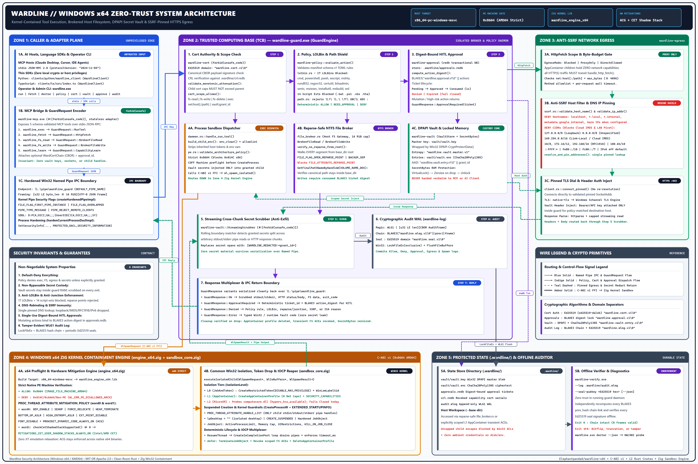

# Wardline (`win-x64`) — System Architecture Specification

This document provides the deep technical specification of **Wardline (`win-x64`)**, detailing process boundaries, C-ABI v1 FFI contracts between Rust and Zig, Win32 kernel isolation mechanics, IPC wire framing, and cryptographic state formats.

  

> Lossless vector source: [`assets/architecture-x64.svg`](../assets/architecture-x64.svg) (`3600×2400` SVG) • Ultra-HD raster: [`assets/architecture-x64.png`](../assets/architecture-x64.png) (`4800×3200` PNG).

---

## 1. Five-Zone Architectural Partitioning

Wardline separates **untrusted parsing & AI protocol adapters** from the **Trusted Computing Base (`wardline-guard`)** and delegates **OS-level containment & mitigation primitives** to a minimal Zig static library compiled natively for `x86_64-windows-msvc`.

### Zone 1: Caller & Protocol Adapter Plane (Unprivileged Edge)

Components outside the TCB:
- **MCP Hosts & Language SDKs**: Claude Desktop, Cursor, IDE agents, [`clients/python/wardline_client/`](../clients/python/wardline_client/__init__.py), [`clients/ts/src/index.ts`](../clients/ts/src/index.ts), and `wardline.exe`.
- **`wardline-mcp.exe` (`#![forbid(unsafe_code)]`)**: Reads newline-delimited JSON-RPC 2.0 on `stdin`, responds on `stdout`, ignores JSON-RPC notifications (no `id`), and speaks MCP `protocolVersion: "2024-11-05"`. It holds **no vault keys, no child process handles, and no network sockets**.
- **Hardened Named Pipe IPC Transport**:
  - Default pipe: `DEFAULT_PIPE_NAME = r"\\.\pipe\wardline_guard"`.
  - Wire framing: `[u32 LE length <= MAX_IPC_FRAME_BYTES (16 MiB)][UTF-8 JSON GuardRequest/GuardResponse]`.
  - Server flags applied via Zig/Win32 `createHardenedPipeImpl`:
    - `PIPE_ACCESS_DUPLEX | FILE_FLAG_FIRST_PIPE_INSTANCE | FILE_FLAG_OVERLAPPED` (prevents pipe-squatting / impersonation hijack by another local process attaching a second server instance).
    - `PIPE_TYPE_BYTE | PIPE_READMODE_BYTE | PIPE_WAIT | PIPE_REJECT_REMOTE_CLIENTS` (blocks SMB/network named-pipe relay attacks while preserving exact length-prefixed framing).
    - Explicit Protected SDDL: `D:P(A;OICI;GA;;;{UserSID})(A;OICI;GA;;;SY)` granting access exclusively to the launching user SID and `SYSTEM`.
  - Process DACL hardening (`hardenCurrentProcessDaclImpl`): calls `SetSecurityInfo(..., SE_KERNEL_OBJECT, DACL_SECURITY_INFORMATION | PROTECTED_DACL_SECURITY_INFORMATION, ...)` so ambient same-session tools cannot inspect `wardline-guard.exe` memory.

### Zone 2: Trusted Computing Base (`wardline-guard.exe` / `GuardEngine`)

Every `GuardRequest` (`Health`, `CapabilityLearn`, `RunTool`, `HttpFetch`, `BrokerFileRead`, `BrokerFileWrite`) passes through an ordered pipeline in [`daemon.rs`](../crates/wardline-guard/src/daemon.rs):

1. **Identity & Delegation (`wardline-cert`)**:
   - When `--require-cert` or a cert chain is provided, validates the `Ed25519` signature chain over canonical CBOR (`domain = b"wardline.cert.v1\0"`) back to `--root-pubkey`.
   - Enforces `validate_monotonic_attenuation()` across every parent → child link (TTL non-increasing, isolation level non-weakening, arch compatibility, remaining depth strictly decreasing, capabilities subset-checked).
   - Consults durable `.wardline/crl.redb` for revoked certificate UUIDs.
   - Evaluates `cert_scope_allows()` against canonical scopes (`fs-read:`, `fs-write:`, `fs-delete:`, `exec:`, `net:host[:/path]`, `vault:id`).
2. **Policy, LOLBin & Path Shield (`wardline-policy` + `wardline-core`)**:
   - Validates executable paths against `lolbin.rs` (**25 LOLBins / 50 binary+bare patterns** + **19 blocked script extensions**) even when trailing dots or mixed casing are attempted.
   - Rejects Win32 namespace escapes (`\\?\`, `\\.\`, `\??\`), UNC paths (`\\`), drive-relative paths (`C:foo`), and NTFS Alternate Data Streams (`:`).
   - Enforces canonical segment-boundary case-insensitive matching inside allowed workspace trees.
3. **Digest-Bound HITL Approval (`wardline-approval`)**:
   - Computes `BLAKE3("wardline.approval.v1\0" || canonical_action || "\0" || payload_binding)`.
   - Stores and consumes tickets in transactional `redb` (`approvals.redb`). Tickets follow `Pending -> Approved -> Consumed` (single-use) or fail closed (`Denied` / `Expired`).
4. **Three Controlled Dispatch Paths**:
   - **4A. Process Sandbox Dispatcher**: `build_child_env()` runs `env_clear()` + policy allowlist (rejecting control chars), verifies native `0x8664` PE header via `wardline-core::pe` (secrets stay isolated from child spawn env and are injected strictly by `wardline-egress`), and invokes `wl_spawn_isolated` over C-ABI v1 FFI.
   - **4B. Reparse-Safe NTFS File Broker (`file_broker.rs`)**: Handles `BrokerFileRead` / `BrokerFileWrite` up to 16 MiB. Calls `verify_no_reparse_from_root()`, opening each path component with `FILE_FLAG_OPEN_REPARSE_POINT | FILE_FLAG_BACKUP_SEMANTICS`, failing immediately on `FILE_ATTRIBUTE_REPARSE_POINT` (NTFS junctions / symlinks), verifying final path resolution via `GetFinalPathNameByHandleW(..., VOLUME_NAME_DOS)` remains anchored under `--base-dir`, and consuming a matching `BLAKE3` approval ticket for writes.
   - **4C. DPAPI Vault & Locked Memory (`wardline-vault`)**: Stores master symmetric key in `vault/vault.key` wrapped via Win32 `CryptProtectData` (optional entropy `b"wardline.vault.master.v1"`), encrypts secret records in `vault/vault.enc` with `ChaCha20Poly1305` (AAD `b"wardline.vault.entry.v1\0" || grant_id`), and holds decrypted secret buffers in `SecretBytes` (`VirtualLock` → `Zeroize` → `VirtualUnlock`).
5. **Streaming Anti-Exfiltration Scrubber (`scrub.rs`, `#![forbid(unsafe_code)]`)**:
   - Passes child `stdout`/`stderr` and egress HTTP headers/bodies through `StreamingScrubber`, detecting granted secret bytes across arbitrary chunk split boundaries and replacing them with `[WARDLINE_REDACTED:<grant_id>]`.
6. **Cryptographic Audit WAL Builder (`wardline-log`)**:
   - Acquires exclusive blocking lock (`LockFileEx`), serializes `CBOR AuditFrame` records prefixed with `[u32 LE len]` after `WLG1` file header magic, hashes with `BLAKE3("wardline.wlog.v1\0" || prev_hash || frame_cbor)`, periodically signs checkpoints using `Ed25519` (`"wardline.seal.v1\0"`), and calls `FlushFileBuffers()`.
7. **Response Multiplexer**:
   - Serializes `GuardResponse::{Ok, ApprovalRequired, Denied, Error}` cleanly back over the Named Pipe.

### Zone 3: Anti-SSRF Egress Router (`wardline-egress`)

Because `L1 AppContainer` children hold **zero network capabilities**, outbound requests route through `GuardEngine::handle_http_fetch()`:
1. Validates URL scheme, `EgressMode` (`Blocked` / `ProxyOnly` / `DirectAllowed`), `allowed_destinations`, cert `net:` scope, response size budget (`max_bytes_per_request.max(4096)`), and HITL approval if required (e.g., mutating `POST`/`PUT`/`PATCH`/`DELETE`).
2. `validate_host_name()` blocks `localhost`, `.local`, `.internal`, `metadata.google.internal`, and literal disallowed IPs.
3. `resolve_and_pin_addresses()` performs DNS lookup **once**, runs `validate_ip_addr()` against every candidate IP (blocking `0.0.0.0/8`, `127.0.0.0/8`, `169.254.0.0/16` IMDS, RFC1918 private blocks, `100.64.0.0/10` CGNAT, `198.18.0.0/15`, multicast, `::ffff:` IPv4-mapped, `fe80::/10`, `fc00::/7`, and IPv6 by default), and pins the `SocketAddr`.
4. `connect_pinned()` connects directly to the pinned address without a second DNS query (preventing DNS rebinding TOCTOU), establishes TLS via `native-tls` (Windows Schannel), injects the host-bound vault header only if `grant.host` matches cleanly, streams response parsing via `httparse`, and scrubs headers/body via `StreamingScrubber`.

### Zone 4: Zig `x64` Kernel Containment Engine (`wardline_engine_x64`)

Implemented in [`platforms/win-x64/engine_x64.zig`](../platforms/win-x64/engine_x64.zig) + [`platforms/common/sandbox_core.zig`](../platforms/common/sandbox_core.zig), linked statically by `wardline-sandbox`:

#### C-ABI v1 Surface (`wardline_abi.h`)

| Exported Symbol | Signature Summary | Purpose |
| :--- | :--- | :--- |
| `wl_engine_abi_version` | `() -> u32` | Returns `WARDLINE_ABI_VERSION` (`1`). |
| `wl_engine_arch` | `() -> u32` | Returns `WL_ARCH_X64` (`1`). |
| `wl_probe_capabilities` | `(WlHostCapabilities*) -> u32` | Probes `RtlGetVersion`, `GetNativeSystemInfo`, `IsWow64Process2`, CET (`ProcessUserShadowStackPolicy`), and `computecore.dll` HCS availability. |
| `wl_classify_pe` | `(const uint8_t*, size_t) -> u32` | Classifies COFF Machine bytes (`0x8664` AMD64, `0x014C` x86, `0xAA64` ARM64, `0xA641` ARM64EC, non-PE script). |
| `wl_spawn_isolated` | `(const WlSpawnRequest*, WlIoBuffers*, WlSpawnResult*) -> u32` | Verifies `0x8664` PE on disk (`WL_ERR_PE_DISALLOWED_ARCH` on mismatch), constructs Win32 mitigations, executes `executeIsolatedChild`, returns exit code / RSS / CPU time / stdout / stderr. |
| `wl_create_hardened_pipe` | `(const uint8_t*, size_t, size_t*, uint32_t*) -> u32` | Creates first-instance, remote-rejecting overlapped Named Pipe with protected user+SYSTEM SDDL. |
| `wl_set_owner_only_dacl_utf8` | `(const uint8_t*, size_t, uint8_t, uint32_t*) -> u32` | Locks files/directories to owner+SYSTEM protected ACLs. |
| `wl_harden_current_process_dacl` | `(uint32_t*) -> u32` | Protects daemon process DACL via `SetSecurityInfo`. |

#### `x64` Mitigation Policy Matrix (`engine_x64.zig`)

Before `CreateProcessW` launches the child suspended:
- **`word0` always applied**:
  - `MITIGATION_DEP_ENABLE`
  - `MITIGATION_SEHOP_ENABLE`
  - `MITIGATION_FORCE_RELOCATE_IMAGES_ALWAYS_ON`
  - `MITIGATION_HEAP_TERMINATE_ALWAYS_ON`
  - `MITIGATION_BOTTOM_UP_ASLR_ALWAYS_ON`
  - `MITIGATION_HIGH_ENTROPY_ASLR_ALWAYS_ON`
  - `MITIGATION_EXTENSION_POINT_DISABLE_ALWAYS_ON`
  - `MITIGATION_FONT_DISABLE_ALWAYS_ON`
- **`word0` when `enable_acg != 0`**:
  - `MITIGATION_PROHIBIT_DYNAMIC_CODE_ALWAYS_ON` (Arbitrary Code Guard)
- **`word1` when `enable_cet != 0` and `checkCetShadowStackSupported() != 0`**:
  - `MITIGATION2_CET_USER_SHADOW_STACKS_ALWAYS_ON` (hardware Control-flow Enforcement Technology)

#### Common Isolation Container (`sandbox_core.zig`)

- **`L0` (`WL_ISOLATION_L0_RESTRICTED_JOB`)**: `CreateRestrictedToken(..., DISABLE_MAX_PRIVILEGE)` + `WinLowLabelSid` (`S-1-16-4096`) + `JobObject` + IOCP.
- **`L1` (`WL_ISOLATION_L1_APPCONTAINER`, default)**: Creates transient AppContainer profile via `CreateAppContainerProfile` (0 network/device capabilities), attaches `SECURITY_CAPABILITIES` via `PROC_THREAD_ATTRIBUTE_SECURITY_CAPABILITIES`, grants transient scoped FS read/write ACEs, launches child `CREATE_SUSPENDED` with `lpDesktop = ""` and strict `PROC_THREAD_ATTRIBUTE_HANDLE_LIST` (only anonymous pipe handles), assigns to `JobObject` (`KILL_ON_JOB_CLOSE`, active process/memory/CPU/UI limits), pumps IOCP + pipes until exit or wall-clock `timeout_ms`, then **terminates the job tree, revokes transient ACEs, and calls `DeleteAppContainerProfile` in `defer`**.
- **`L2` (`WL_ISOLATION_L2_MICROVM`)**: Probes `computecore.dll` capability in `wl_probe_capabilities`; fail-closed at spawn (`WL_ERR_NOT_SUPPORTED_ARCH`) while HCS/WHPX guest runner integration is staged.

### Zone 5: Persistent State & Offline Auditor

Directory `.wardline/`:
- `vault/vault.key` — DPAPI-protected master key blob
- `vault/vault.enc` — `ChaCha20Poly1305` sealed credentials map
- `approvals.redb` — Durable ACID ticket & digest store
- `crl.redb` — Revoked `WardCert` serial UUIDs
- `audit.wlog` — Binary `WLG1` chained audit log

`wardline-verify.exe` opens `audit.wlog` completely offline without IPC or daemon interaction, verifying the `WLG1` header, sequential `prev_hash` (`BLAKE3`) transitions across every frame, and every `Ed25519` seal checkpoint.

---

## 2. Memory-Safety & `unsafe` Audit Boundary

| Crate / Module | Safety Discipline | Role |
| :--- | :--- | :--- |
| `wardline-core`, `wardline-policy`, `wardline-cert`, `wardline-approval`, `wardline-egress`, `wardline-mcp`, `wardline-verify`, `wardline-cli` | `#![forbid(unsafe_code)]` | All parsing, cert crypto, policy evaluation, SSRF validation, MCP JSON-RPC, WAL verification. |
| `wardline-vault/src/scrub.rs`, `wardline-guard/src/{daemon,protocol}.rs` | `#![forbid(unsafe_code)]` | Orchestration loop, wire protocol, cross-chunk redaction. |
| `wardline-vault/src/{dpapi,acl}.rs`, `wardline-log/src/lock.rs`, `wardline-guard/src/{file_broker,pipe_server}.rs`, `wardline-sandbox/src/lib.rs` | Localized `windows-sys` FFI `unsafe` | `CryptProtectData`, `VirtualLock`, `LockFileEx`, `FILE_FLAG_OPEN_REPARSE_POINT`, `GetFinalPathNameByHandleW`, Named Pipe I/O, C-ABI v1 FFI calls. |
| `platforms/win-x64/engine_x64.zig`, `platforms/common/sandbox_core.zig` | Zig native Win32 FFI | `CreateProcessW`, `UpdateProcThreadAttribute`, `CreateAppContainerProfile`, JobObjects, IOCP. |
